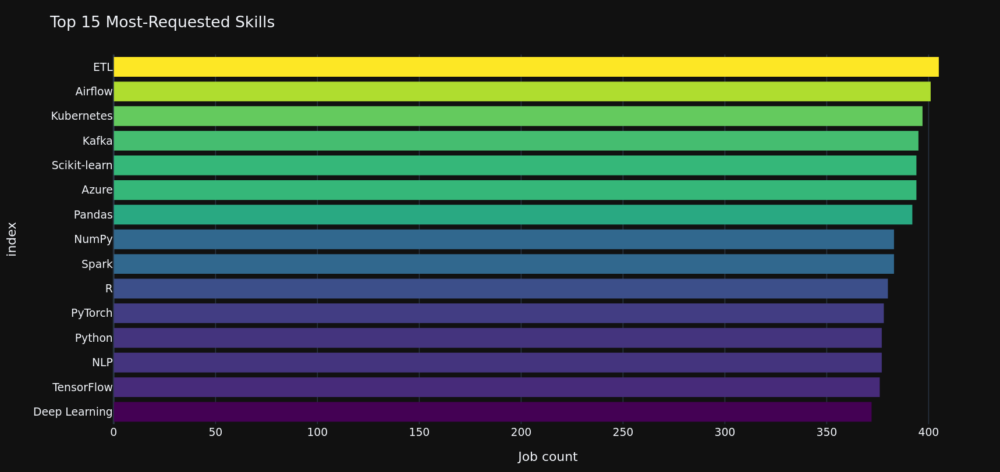
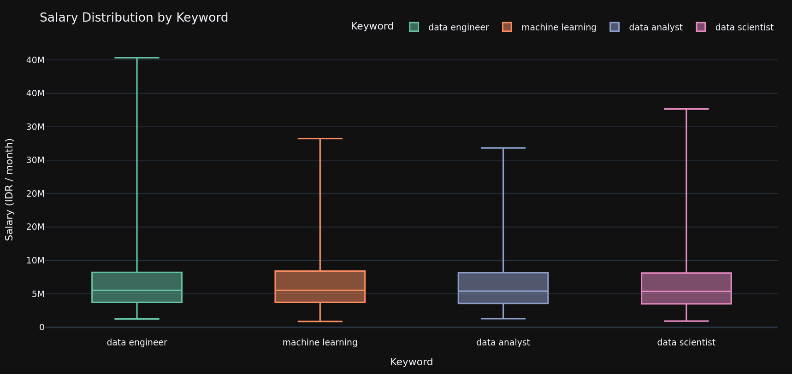
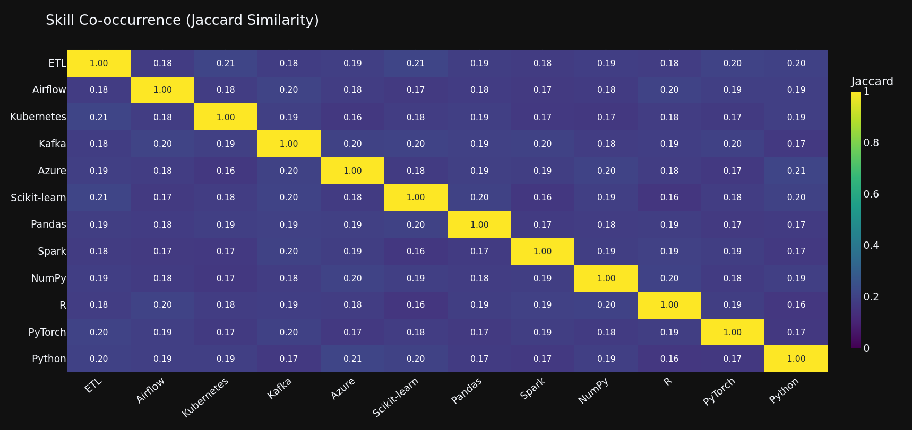
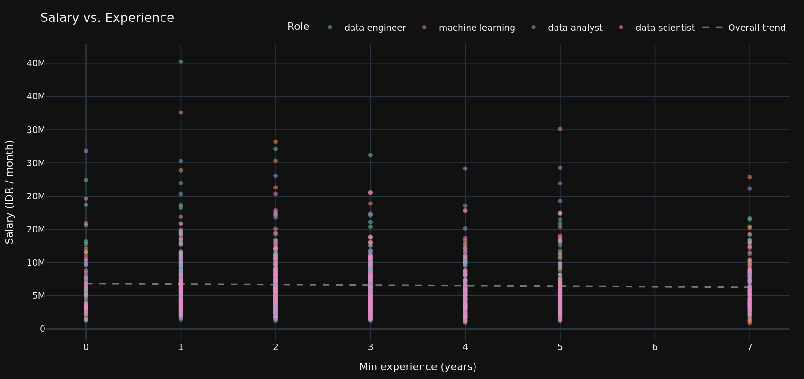

# Glints Job Intel

Interactive dashboard and exploratory analysis of Indonesia's data-job market.

The project turns public Glints job postings into a cleaned dataset and uses
them to answer practical questions:

- Which data roles and skills appear most often?
- How does salary vary by role, experience, and workplace type?
- Where are data jobs concentrated in Indonesia?
- How common are remote and hybrid opportunities?

## Explore The Project

| What you want to do | Open |
|---|---|
| Try the interactive dashboard | [Streamlit app](#live-dashboard) |
| Read the complete analysis without installing Python | [`eda_report.html`](eda_report.html) |
| Inspect or rerun the analysis | [`eda.ipynb`](eda.ipynb) |
| Run the dashboard locally | [Local setup](#run-locally) |
| Reproduce the scrape yourself | [`docs/reproduce.md`](docs/reproduce.md) |

## Live Dashboard

Add the deployed Streamlit URL here before publishing the repository:

> **Live app:** deploy `app/dashboard.py` with Streamlit Community Cloud.

The live app and the local dashboard use the same cleaned snapshot. No Glints
account, secret, or scraping step is needed to view the portfolio.

## Key Findings

These findings are calculated from the committed snapshot in
`data/processed/master_dataset_eda.csv`. They describe job-posting mentions,
not the entire labour market.

- **Skills:** SQL, Python, and reporting/visualisation tools form the core of
  the dataset's technical demand.
- **Location:** Jakarta is the largest job hub in this snapshot, with other
  cities contributing smaller shares.
- **Workplace:** On-site roles remain common; remote and hybrid roles are
  visible but form a smaller part of the snapshot.
- **Experience:** Most postings ask for previous experience, so the
  fresh-graduate segment is comparatively narrow.
- **Salary:** Salary comparisons are conditional on disclosure because many
  postings do not publish a salary range.

## Preview

The static chart previews are generated from the same chart functions used by
the dashboard. They are useful when reviewing the repository on GitHub.

| Skills | Salary |
|:---:|:---:|
|  |  |
| **Skill co-occurrence** | **Salary vs experience** |
|  |  |

See [`assets/charts/`](assets/charts/) for the complete set of generated
previews.

## Run Locally

The repository includes a cleaned demo snapshot. The normal path is only a few
commands and does not use Playwright:

```bash
git clone https://github.com/<your-username>/glints-job-intel.git
cd glints-job-intel
python -m venv .venv
source .venv/bin/activate        # macOS/Linux
# .venv\Scripts\activate         # Windows PowerShell
pip install -r requirements.txt
streamlit run app/dashboard.py
```

Then open the local URL printed by Streamlit, normally
`http://localhost:8501`.

To build the standalone report from the notebook:

```bash
pip install -r requirements-dev.txt
make eda-report
```

You can also open the already-generated `eda_report.html` directly in a
browser. It does not need a running Python server.

## Reproduce From Scratch

Scraping is an optional advanced path, not a prerequisite for reviewing the
portfolio. It requires a Glints account and a local Playwright session:

```bash
pip install -r requirements-scraper.txt
pip install -e ".[scraper]"
playwright install chromium
playwright codegen --storage-state=secrets/auth.json https://glints.com/id/login
make scrape-links
make scrape-details
make pipeline
```

Read [`docs/reproduce.md`](docs/reproduce.md) before running it. The scraper
uses resumable files in `data/raw/`, respects a polite delay, and must never be
run with a committed or shared `auth.json`.

## How The Pipeline Works

```text
Glints listing pages
        |
        v
Playwright + parsel scraper  -->  data/raw/job_details.csv
        |
        v
transform.py                 -->  data/processed/master_dataset_eda.csv
        |
        +--> eda.ipynb / eda_report.html
        |
        +--> Streamlit dashboard
```

The cleaning stage parses IDR salary ranges, normalises experience and
education, classifies workplace type, maps locations to canonical cities, and
detects 32 skill flags from descriptions and skill tags. The detailed column
definitions are in [`docs/schema.md`](docs/schema.md).

## Project Structure

```text
glints-job-intel/
├── app/                       # Streamlit UI, charts, data loading, map
├── data/processed/            # Versioned cleaned demo snapshot
├── data/sample/               # Small fallback fixture for tests/examples
├── docs/                      # Schema and optional scrape instructions
├── scripts/                   # Asset and local pipeline helpers
├── src/glints_scraper/        # Scraping and transformation package
├── tests/                     # Offline unit and smoke tests
├── clean.ipynb                # Cleaning walkthrough
├── eda.ipynb                  # Exploratory analysis
├── eda_report.html            # Shareable standalone report
├── requirements.txt           # Dashboard dependencies
├── requirements-scraper.txt   # Optional Playwright/parsel dependencies
└── Makefile                   # Common commands
```

## Methodology And Limitations

- The data comes from Glints Indonesia and represents one snapshot in time.
- A job posting is counted once per row; repeated postings or employer volume
  are not weighted by company size.
- Salary metrics use disclosed `salary_avg` values only. Undisclosed salaries
  remain as missing values.
- Skill flags are substring-based mentions. They do not prove that a skill is
  mandatory or that a candidate uses it in a particular way.
- City detection is a best-effort normalisation of free-text locations.
- The four scraper search keywords do not cover every possible data role.

## Development

```bash
pip install -r requirements-dev.txt
make test
```

The test suite is offline and does not require a Glints account or Chromium.

## License

[MIT](LICENSE)
