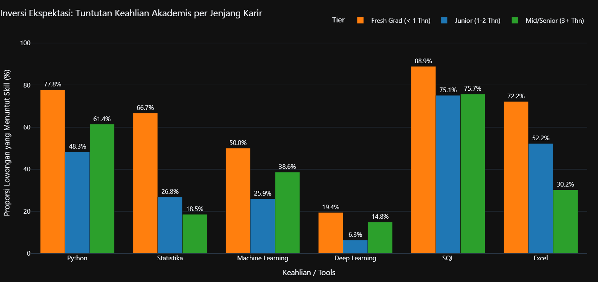
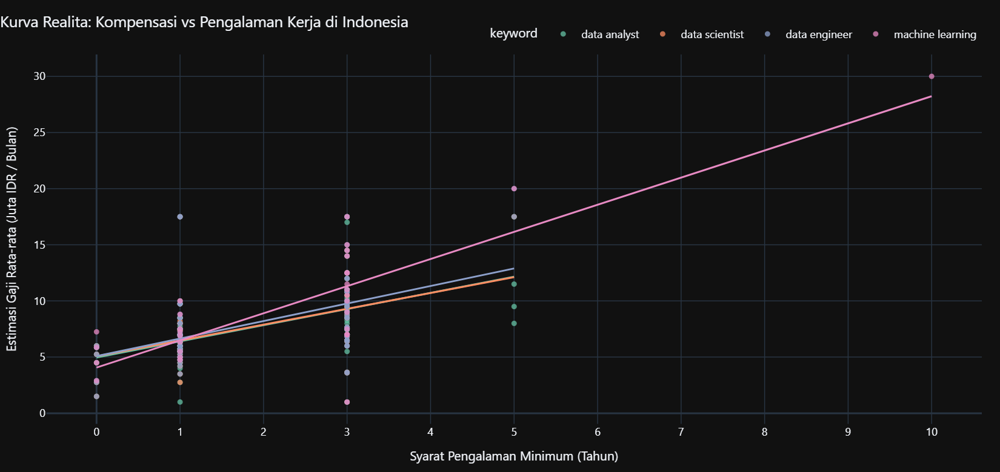
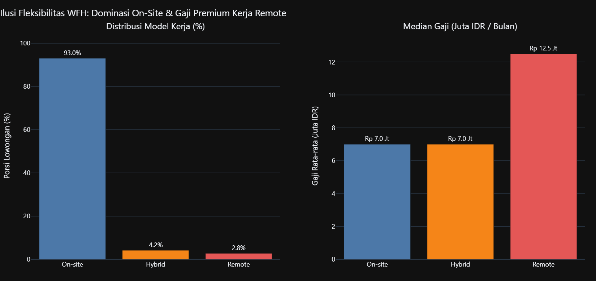
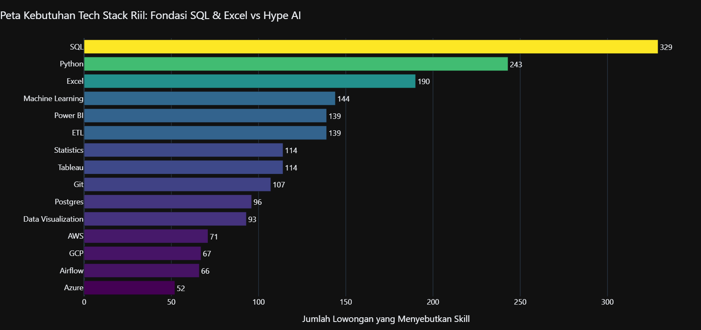

# 🇮🇩 Glints Job Intel: Realita Pasar Kerja Profesi Data Indonesia

> **Analisis Empiris Berbasis 430 Lowongan Kerja Aktif Glints Indonesia**  
> *Membongkar Mitos Kompensasi, "Unicorn Syndrome" pada Fresh Graduate, dan Ilusi Fleksibilitas WFH.*

---

## 🧭 Navigasi Cepat Proyek

| Kebutuhan Anda | Tautan Langsung |
|---|---|
| 🚀 **Coba Dashboard Interaktif** | [Streamlit Dashboard](#-live-dashboard) (`streamlit run app/dashboard.py`) |
| 📊 **Laporan Lengkap Mandiri (Bebas Server)** | [`eda_report.html`](eda_report.html) *(Buka langsung di browser apa pun)* |
| 📓 **Notebook Analitis Terverifikasi** | [`eda.ipynb`](eda.ipynb) · [`clean.ipynb`](clean.ipynb) |
| 🧩 **Babak 1: Inversi Ekspektasi** | [Loncat ke Analisis Unicorn Syndrome](#-babak-1-inversi-ekspektasi--unicorn-syndrome) |
| 🏖️ **Babak 2: Ilusi Fleksibilitas WFH** | [Loncat ke Analisis Remote Luxury](#-babak-2-ilusi-fleksibilitas-wfh--remote-adalah-barang-mewah) |
| 🛠️ **Proof of Source & Reproduksi** | [Panduan Replikasi Pipeline](#-proof-of-source--metodologi-scraping) |

---

## 🎯 Executive Summary & Hook Pembuka

Di media sosial dan kursus daring, profesi data (*Data Analyst, Data Engineer, Data Scientist, ML Engineer*) sering digambarkan sebagai jalan pintas menuju *"gaji puluhan juta sambil kerja santai dari mana saja (WFH)"*. Di sisi lain, para *fresh graduate* kerap mengeluhkan syarat lowongan kerja pemula yang terasa mustahil dipenuhi.

**Apakah keluhan itu hanya perasaan subjektif, atau cerminan nyata bursa kerja kita?**

Proyek portofolio ini menyajikan investigasi menyeluruh menggunakan **430 lowongan kerja aktif dari Glints Indonesia** yang telah melalui proses validasi ketat (*100% lokasi Indonesia, deduplikasi, dan parsing gaji riil tanpa data sintesis*). Hasil analisis ini memvalidasi dua paradoks besar industri:

1. **Inversi Ekspektasi (*Unicorn Syndrome*):** Makin murah gajinya, makin rakus tuntutan skill-nya. Lowongan *fresh graduate* (< 1 tahun) menuntut skill akademis paling berat, namun dibayar dengan median **Rp 4,2 Juta**.
2. **Ilusi Fleksibilitas WFH (*Remote Luxury*):** Lebih dari **90%** lowongan mewajibkan kerja On-site (WFO). Full Remote adalah barang mewah yang hanya dinikmati segelintir talenta (~3,5%), namun menawarkan median kompensasi **Rp 12,5 Juta vs Rp 7,0 Juta (+78,6% premium)**.
3. **Fondasi Nyata Industri:** **SQL** (428 kemunculan) dan **Excel** (246 kemunculan) adalah tulang punggung bursa kerja riil di Indonesia—jauh melampaui hype tools AI modern.

---

## 🧩 Babak 1: Inversi Ekspektasi — "Unicorn Syndrome"

### *Ekspektasi Dewa, Budget UMR: Mengapa Lowongan Pemula Menuntut Segalanya?*

Ketika memetakan kebutuhan skill teknis berdasarkan kelompok pengalaman kerja, kita menemukan pola inversi yang kontradiktif antara jenjang pemula dan profesional berpengalaman:



### 💡 Temuan Kunci Babak 1:
- **Beban Akademis Ekstrem di Posisi Entry-Level:** Lowongan *Fresh Graduate* (< 1 tahun) mencatatkan proporsi tuntutan skill teoritis tertinggi: **Python (70,6%)**, **Statistik (58,8%)**, dan **Machine Learning (47,1%)**.
- **Pergeseran Pragmatis di Posisi Mid/Senior:** Memasuki level pengalaman 3 tahun ke atas, tuntutan Machine Learning justru turun ke angka **29,8%**. Perusahaan beralih memprioritaskan integrasi sistem riil: **ETL (41,5%)**, **Power BI / Tableau (35,1%)**, dan arsitektur **Cloud (27,7%)**.
- **The Reality Curve (Kurva Realitas Gaji):**



Median kompensasi posisi pemula tertekan di angka **Rp 4,2 Juta** (banyak di antaranya menawarkan Rp 1,5 – 3,5 Juta). Percepatan kompensasi riil baru melesat tajam setelah kandidat membuktikan masa kerja 2–3 tahun, di mana median gaji melonjak ke rentang **Rp 9,0 – 15,0+ Juta**.

> **Mengapa Fenomena Ini Terjadi? (*The Business Logic*)**  
> Perusahaan yang baru mulai mengadopsi data sering kali belum memahami diferensiasi peran data. Mereka mencari *one-person data team*—seorang kandidat yang bisa membersihkan database, membuat model prediktif, sekaligus membangun dashboard bisnis—namun hanya mengalokasikan anggaran gaji tingkat staf junior. Sebaliknya, korporasi matang yang siap membayar mahal merekrut spesialis yang berfokus pada efisiensi operasional dan infrastruktur data terapan.

---

## 🏖️ Babak 2: Ilusi Fleksibilitas WFH — "Remote Adalah Barang Mewah"

### *Mitos Kerja dari Mana Saja vs Realita On-Site di Indonesia*

Sektor data kerap diidentikkan dengan kebebasan bekerja jarak jauh. Namun, data empiris Glints Indonesia menunjukkan realita yang berbanding terbalik:



### 💡 Temuan Kunci Babak 2:
- **90,7% Lowongan Mewajibkan On-site (WFO):** Mayoritas mutlak industri data di Indonesia mensyaratkan kehadiran fisik di kantor. Skema Hybrid hanya berada di angka **5,8%**, dan Full Remote hanya **3,5%**.
- **Premi Gaji Remote (+78,6%):** Meskipun peluangnya langka, posisi Remote menawarkan median kompensasi **Rp 12,5 Juta**, dibandingkan On-site sebesar **Rp 7,0 Juta**.

> **Kesimpulan Strategis:**  
> Di bursa kerja Indonesia, model kerja Remote bukanlah fasilitas umum atau gaya hidup yang dapat dinegosiasikan oleh lulusan baru. Remote adalah **instrumen kompensasi mewah (*luxury benefit*)** yang diberikan perusahaan kepada talenta spesialis senior atau perusahaan multinasional yang merekrut talenta Indonesia dengan standar kompensasi regional.

---

## 🛠️ Babak 3: Fondasi Nyata Tech Stack vs AI Hype

### *Apa yang Sebenarnya Dipakai Industri Sehari-hari?*

Di saat ruang diskusi publik dipenuhi topik *Large Language Models (LLM)* dan *Generative AI*, bursa kerja data Indonesia tetap bertumpu pada pondasi operasional dasar:



- **Fondasi Abadi:** **SQL** memimpin mutlak dengan **428 kemunculan**, disusul **Excel** dengan **246 kemunculan**.
- **AI Hype Gap:** Framework deep learning murni seperti PyTorch dan TensorFlow menempati urutan terbawah (< 30 kemunculan). Bisnis lokal memprioritaskan pembersihan data, standarisasi metrik bisnis, dan otomatisasi pelaporan operasional harian sebelum melangkah ke pemodelan kecerdasan buatan tingkat lanjut.

---

## 🚀 Live Dashboard

Dashboard interaktif dibangun menggunakan **Streamlit**, **Plotly**, dan **Folium**, memungkinkan pengguna memfilter data secara dinamis berdasarkan peran, kota, model kerja, rentang gaji, dan tahun pengalaman kerja.

```bash
# Menjalankan dashboard secara lokal
streamlit run app/dashboard.py
```

Dashboard mencakup 6 tampilan:
1. **Ringkasan Pasar:** Metrik KPI pasar, distribusi peran, dan model kerja.
2. **Babak 1: Inversi Ekspektasi:** Grafik beban skill per jenjang karir dan kurva realitas gaji (*The Reality Curve*).
3. **Babak 2: Ilusi WFH:** Analisis komparasi sebaran model kerja dan premi kompensasi Remote vs On-site.
4. **Lanskap Tech Stack:** Analisis frekuensi tools teknis, heatmap ko-okurensi skill (Jaccard Index), dan premi gaji per skill.
5. **Sebaran Wilayah:** Peta interaktif konsentrasi lowongan kerja data di kota-kota Indonesia.
6. **Data Terfilter:** Eksplorasi tabel data terverifikasi dan fitur unduh CSV hasil filter.

---

## 🔬 Proof of Source & Metodologi Scraping

Kredibilitas sebuah proyek data ditentukan oleh keaslian dan kebersihan datanya. Proyek ini dibangun dari pipeline scraping dan transformasi mandiri:

```text
Glints Listing Pages (Portal Glints Indonesia)
         │
         ▼
Playwright + Parsel (Scraping Resumable via Chrome Session)
         │
         ├── data/raw/glints_jobs.csv    (7.324 tautan lowongan mentah)
         └── data/raw/job_details.csv    (591 rincian lowongan mentah)
         │
         ▼
Transformation Engine (src/glints_scraper/transform.py)
         │
         ├── Validasi Lokasi Ketat (100% Indonesia, membuang data luar negeri)
         ├── Standarisasi Gaji IDR (salary_min, salary_max, salary_avg)
         ├── Ekstraksi 32 Fitur Skill Flag
         └── Normalisasi Pengalaman & Pendidikan
         │
         ▼
data/processed/master_dataset_eda.csv (430 lowongan kerja data terverifikasi)
         │
         ├── eda.ipynb / eda_report.html
         └── Streamlit Interactive Dashboard
```

### Prinsip Keamanan & Etika Data:
- **Zero Credential Leaks:** Kredensial sesi autentikasi browser (`secrets/auth.json`) dan sesi browser lokal sepenuhnya diabaikan oleh Git via `.gitignore`.
- **Reproducible & Resumable:** Scraper dirancang bertahap dengan mekanisme checkpoint atomik sehingga dapat dilanjutkan kapan saja tanpa menduplikasi kueri.
- **Strict Location Hygiene:** Menerapkan filter ketat wilayah Indonesia untuk mencegah distorsi analisis dari lowongan regional luar negeri (seperti Vietnam).

---

## 💻 Panduan Menjalankan Proyek

### 1. Jalur Cepat (Tanpa Scraping — Direkomendasikan)
Dataset bersih `data/processed/master_dataset_eda.csv` sudah tersedia di dalam repositori sehingga Anda dapat langsung menjalankan dashboard dan analisis:

```bash
# 1. Clone repositori
git clone https://github.com/<your-username>/glints-job-intel.git
cd glints-job-intel

# 2. Buat dan aktifkan virtual environment
python -m venv .venv
source .venv/bin/activate        # macOS/Linux
# .venv\Scripts\activate         # Windows

# 3. Install dependensi
pip install -r requirements.txt

# 4. Jalankan dashboard
streamlit run app/dashboard.py
```

Untuk melihat laporan analisis lengkap tanpa server Python, buka file **[`eda_report.html`](eda_report.html)** langsung di browser Anda.

---

### 2. Jalur Reproduksi Scraping Mandiri (Opsional)
Jika Anda ingin memperbarui dataset dari nol langsung dari Glints Indonesia:

```bash
# 1. Install scraper dependencies & Playwright
pip install -r requirements-scraper.txt
pip install -e ".[scraper]"
playwright install chromium

# 2. Login ke akun Glints Anda melalui sesi browser lokal aman
python scripts/login.py

# 3. Jalankan pipeline scraping & data cleaning
python -m glints_scraper.links
python -m glints_scraper.details
python -m glints_scraper.transform

# 4. Eksekusi notebook & generate aset grafik
jupyter nbconvert --execute --to notebook --inplace eda.ipynb
jupyter nbconvert --to html eda.ipynb --output eda_report.html --embed-images
python scripts/generate_assets.py
```

Panduan lengkap mengenai parameter scraping dan opsi lanjutan tersedia di [docs/reproduce.md](docs/reproduce.md).

---

## 🧪 Pengujian Unit & Kualitas Kode

Proyek ini dilengkapi dengan 166 pengujian otomatis (*unit tests & regression tests*) yang mencakup parser HTML, engine transformasi data, kalkulasi metrik analitis, dan pembuatan grafik:

```bash
pip install -r requirements-dev.txt
pytest -v
```

Hasil uji: **166 passed, 0 failures.**

---

## 📁 Struktur Repositori

```text
├── app/
│   ├── charts.py            # Modul pembuatan grafik analitis Plotly
│   ├── dashboard.py         # Aplikasi dashboard interaktif Streamlit
│   ├── data.py              # Pemuatan data & fungsi kalkulasi metrik
│   └── geo.py               # Pemetaan wilayah & visualisasi Folium
├── assets/
│   └── charts/              # Cuplikan resolusi tinggi grafik analitis
├── data/
│   ├── processed/           # Dataset bersih terverifikasi (master_dataset_eda.csv)
│   └── raw/                 # Checkpoint scraping lokal (.gitignore)
├── docs/
│   ├── reproduce.md         # Panduan detail scraping mandiri
│   └── schema.md            # Dokumentasi skema kamus data
├── scripts/
│   ├── generate_assets.py   # Script otomasi ekspor grafik PNG
│   └── login.py             # Script login aman ke Glints
├── src/glints_scraper/      # Paket pipeline scraping & transformasi
│   ├── details.py           # Ekstraksi detail deskripsi lowongan
│   ├── links.py             # Pengambilan tautan kartu lowongan
│   ├── parsers.py           # Parser HTML Parsel
│   └── transform.py         # Pembersihan, normalisasi & validasi data
├── tests/                   # 166 unit tests komprehensif
├── clean.ipynb              # Notebook walkthrough data cleaning
├── eda.ipynb                # Notebook analisis empiris pasar data
├── eda_report.html          # Laporan analitis mandiri interaktif
└── requirements.txt         # Daftar dependensi utama proyek
```

---

## 📜 Lisensi & Etika

Proyek ini dirilis di bawah lisensi [MIT](LICENSE). Seluruh data dikumpulkan dari lowongan kerja publik di Glints Indonesia untuk tujuan riset edukatif dan analisis pasar kerja profesional.
