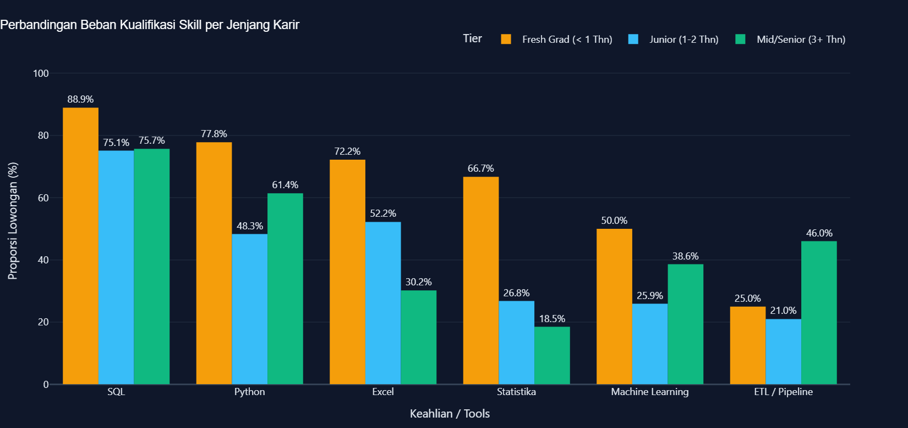
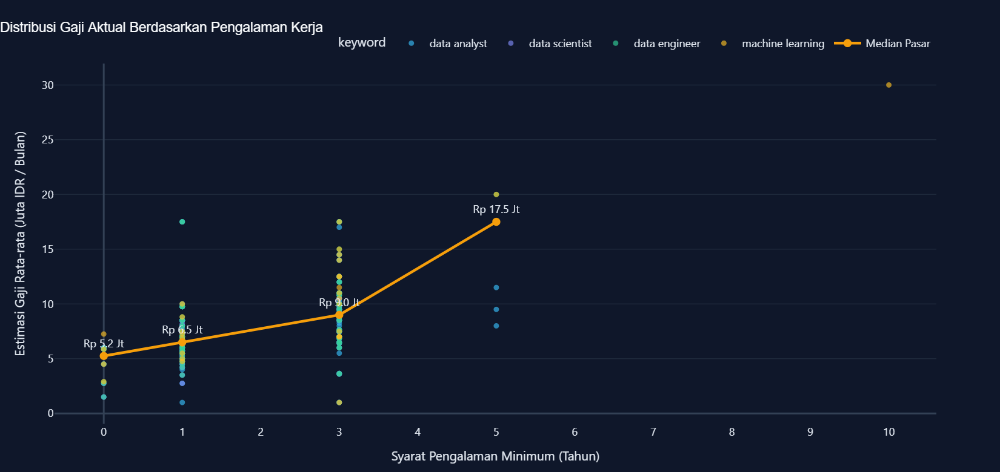
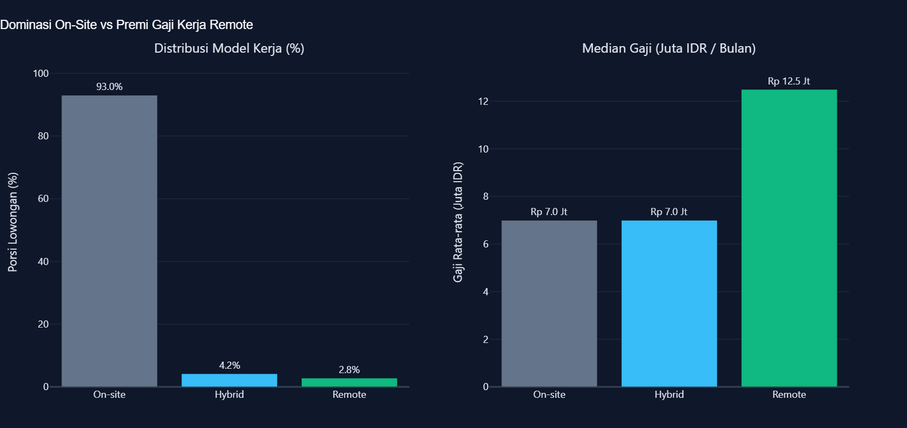
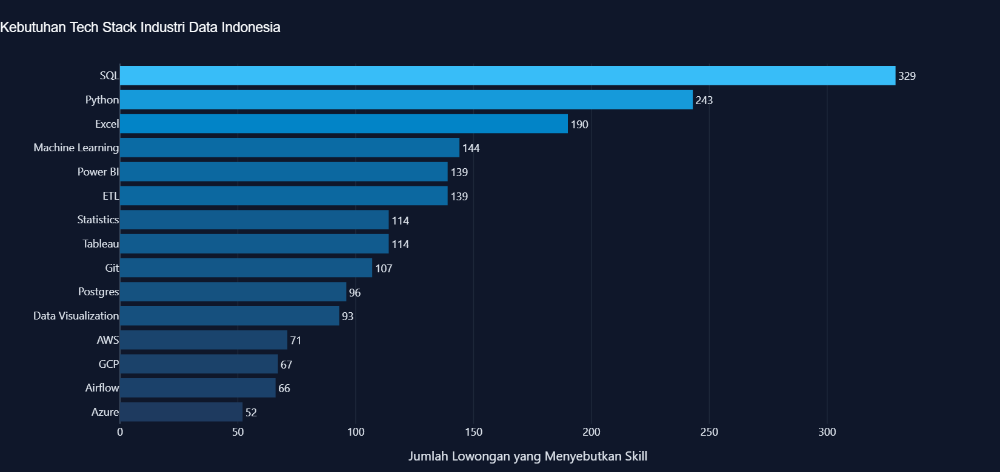

# Analisis Pasar Kerja Profesi Data di Indonesia

Proyek ini menganalisis 430 lowongan kerja aktif di bidang data (*Data Analyst, Data Engineer, Data Scientist, ML Engineer*) dari portal Glints Indonesia. Fokus utamanya melihat sebaran gaji, perbandingan syarat masuk untuk pemula dan level senior, serta *tech stack* yang paling banyak dicari perusahaan di Indonesia.

- Dashboard interaktif bisa dijalankan secara lokal lewat `streamlit run app/dashboard.py`
- Laporan lengkap tersedia di [`eda_report.html`](eda_report.html) dan bisa dibuka langsung di browser tanpa instalasi Python
- Notebook analisis ada di [`eda.ipynb`](eda.ipynb) dan proses pembersihan data ada di [`clean.ipynb`](clean.ipynb)

---

## Temuan Utama

### 1. Tuntutan Kualifikasi Entry-Level dan Pergeseran di Level Senior

Hanya 8,4% lowongan (36 dari 430) yang terbuka untuk *Fresh Graduate* tanpa pengalaman kerja. Sebanyak 91,6% sisanya mensyaratkan minimal 1 tahun pengalaman, terbagi menjadi 47,7% untuk pengalaman 1 sampai 2 tahun dan 43,9% untuk pengalaman 3 tahun ke atas.

Lowongan untuk *Fresh Graduate* (kurang dari 1 tahun) justru meminta daftar skill dasar dan teori paling banyak. Permintaan ini mencakup SQL (88,9%), Python (77,8%), Excel (72,2%), Statistika (66,7%), dan Machine Learning (50,0%). Untuk posisi awal ini, median gajinya berada di angka Rp 5,25 juta/bulan (kuartil bawah Rp 2,9 juta sampai kuartil atas Rp 5,86 juta). Di level *Junior* (1 sampai 2 tahun), median gaji naik sedikit ke Rp 6,5 juta/bulan.



Kondisi ini terjadi karena banyak perusahaan yang baru membangun tim data langsung mencari satu orang untuk mengurus semuanya, mulai dari olah data harian sampai pemodelan, tetapi dengan anggaran gaji level pemula.

Di level *Mid* dan *Senior* (3 tahun ke atas), syarat penguasaan spreadsheet dasar dan teori mulai turun. Permintaan Excel turun dari 72,2% ke 30,2% dan Statistika turun dari 66,7% ke 18,5%. Kebutuhan perusahaan bergeser ke pengelolaan sistem data produksi. Permintaan untuk ETL atau Data Pipeline naik dari 25,0% ke 46,0%, sementara arsitektur Cloud (AWS, GCP, atau Azure) naik dari 13,9% ke 28,0%. Kenaikan gaji yang signifikan baru terlihat saat masuk ke level *Mid-Level* (pengalaman 3 tahun dengan median Rp 9,0 juta/bulan) dan *Senior* (pengalaman 5 tahun ke atas dengan median Rp 17,5 juta/bulan).



---

### 2. Terpusatnya Lokasi Kerja dan Minimnya Posisi Remote

Lowongan kerja data di Indonesia masih didominasi sistem kerja di kantor. Sebanyak 93,0% lowongan (400 posisi) mewajibkan kehadiran penuh di kantor (On-site atau WFO), sedangkan skema Hybrid hanya 4,2% (18 lowongan) dan Full Remote cuma 2,8% (12 lowongan).

Dari sisi wilayah, 83,5% lowongan menumpuk di area Jabodetabek (Jakarta 65,8%, Tangerang 13,0%, serta Depok, Bekasi, dan Bogor 4,7%), diikuti Bandung (4,9%) dan Surabaya (4,4%). Wajibnya WFO dan terpusatnya lowongan di Jabodetabek membuat pelamar dari luar daerah harus siap pindah domisili jika mencari kerja.



Meski jumlahnya cuma 2,8%, posisi Full Remote menawarkan median gaji Rp 12,5 juta/bulan. Angka ini 78,6% lebih tinggi dibanding posisi On-site dan Hybrid yang sama-sama memiliki median Rp 7,0 juta/bulan. Di pasar kerja lokal, skema remote umumnya diberikan untuk posisi spesialis level senior atau berasal dari perusahaan berskala regional.

---

### 3. Kebutuhan Tech Stack di Industri

Kebutuhan operasional harian untuk posisi data di Indonesia masih berfokus pada pengelolaan kueri dan pembuatan laporan bisnis.



- Tiga tool utama yang paling banyak diminta adalah SQL (329 lowongan atau 76,5%), Python (243 lowongan atau 56,5%), dan Excel (190 lowongan atau 44,2%).
- Kelompok berikutnya diisi oleh kebutuhan pipeline dan visualisasi data seperti Machine Learning (144 lowongan atau 33,5%), ETL (139 lowongan atau 32,3%), Power BI (139 lowongan atau 32,3%), Tableau (114 lowongan atau 26,5%), dan Statistika (114 lowongan atau 26,5%).
- Framework *Deep Learning* seperti TensorFlow (20 lowongan atau 4,7%) dan PyTorch (18 lowongan atau 4,2%) hanya muncul di bawah 5% dari total lowongan. Mayoritas perusahaan masih fokus merapikan metrik dan alur data operasional sebelum masuk ke penerapan machine learning tingkat lanjut.

---

## Metodologi dan Kualitas Data

Pengumpulan data dilakukan menggunakan pipeline scraping berbasis Playwright dan Parsel untuk mengambil lowongan dari portal Glints Indonesia.

```text
Glints Indonesia Portal
       │
       ▼
Playwright Scraper (links & details)
       │
       ▼
Data Cleaning & Feature Engineering (src/glints_scraper/transform.py)
  ├── Filter lokasi khusus Indonesia (data luar negeri dibuang)
  ├── Parsing gaji IDR (salary_min, salary_max, salary_avg)
  ├── Deteksi 32 fitur boolean skill dari deskripsi & tag
  └── Normalisasi pengalaman, pendidikan, dan model kerja
       │
       ▼
data/processed/master_dataset_eda.csv (430 lowongan terverifikasi)
       │
       ├── eda_report.html & eda.ipynb
       └── Streamlit Interactive Dashboard
```

- Sampel akhir terdiri dari 430 lowongan kerja data (162 Data Analyst, 127 Data Engineer, 103 Data Scientist, dan 38 Machine Learning).
- Sebanyak 349 lowongan (81,2%) mencantumkan angka estimasi gaji. Analisis gaji dihitung langsung dari data yang tersedia tanpa pengisian nilai kosong secara buatan.
- Seluruh sesi browser dan token lokal (`secrets/auth.json`) otomatis diabaikan oleh Git melalui `.gitignore`.

---

## Panduan Menjalankan Proyek

### 1. Menjalankan Dashboard (Tanpa Scraping)

Dataset yang sudah dibersihkan tersedia langsung di dalam repositori. Anda bisa langsung menjalankan dashboard secara lokal lewat perintah berikut.

```bash
# Clone repositori
git clone https://github.com/Hansiongs/indonesia-data-job-market.git
cd indonesia-data-job-market

# Setup virtual environment
python -m venv .venv
source .venv/bin/activate        # macOS/Linux
# .venv\Scripts\activate         # Windows

# Pasang dependensi dan jalankan
pip install -r requirements.txt
streamlit run app/dashboard.py
```

Dashboard akan terbuka di browser pada alamat `http://localhost:8501`.

### 2. Membuka Laporan Mandiri

Hasil analisis lengkap sudah diekspor ke [`eda_report.html`](eda_report.html). File ini bisa langsung dibuka di browser tanpa perlu memasang Python.

### 3. Menjalankan Ulang Scraping (Opsional)

Jika Anda ingin mengambil data terbaru dari portal Glints secara mandiri, jalankan urutan perintah berikut.

```bash
pip install -r requirements-scraper.txt
pip install -e ".[scraper]"
playwright install chromium

# Login sesi browser lokal
python scripts/login.py

# Jalankan pipeline
python -m glints_scraper.links
python -m glints_scraper.details
python -m glints_scraper.transform
```

Penjelasan lengkap mengenai pengaturan jeda request dan penyimpanan checkpoint bisa dibaca di [docs/reproduce.md](docs/reproduce.md).

---

## Pengujian Unit

Proyek ini memiliki 166 unit test otomatis untuk mengecek fungsi parser HTML, pembersihan data, perhitungan statistik, dan pembuatan grafik Plotly.

```bash
pip install -r requirements-dev.txt
pytest -v
```

Seluruh 166 pengujian berjalan lancar tanpa error (166 passed, 0 failures).

---

## Struktur Direktori

```text
├── app/
│   ├── charts.py            # Modul pembuatan grafik Plotly
│   ├── dashboard.py         # Aplikasi dashboard Streamlit
│   ├── data.py              # Pemuatan data & fungsi kalkulasi
│   └── geo.py               # Pemetaan wilayah & visualisasi Folium
├── assets/
│   └── charts/              # File gambar grafik hasil analisis
├── data/
│   ├── processed/           # Dataset bersih (master_dataset_eda.csv)
│   └── raw/                 # Checkpoint hasil scraping lokal (.gitignore)
├── docs/
│   ├── reproduce.md         # Panduan menjalankan ulang scraping
│   └── schema.md            # Penjelasan kolom dan skema data
├── scripts/
│   ├── generate_assets.py   # Script ekspor grafik ke format PNG
│   └── login.py             # Script login sesi Chrome lokal
├── src/glints_scraper/      # Pipeline scraping & transformasi data
│   ├── details.py           # Pengambilan detail deskripsi lowongan
│   ├── links.py             # Pengambilan tautan kartu lowongan
│   ├── parsers.py           # Parser HTML menggunakan Parsel
│   └── transform.py         # Pembersihan, normalisasi & validasi data
├── tests/                   # 166 unit test otomatis
├── clean.ipynb              # Notebook pembersihan data & feature engineering
├── eda.ipynb                # Notebook analisis data
├── eda_report.html          # Laporan analisis mandiri format HTML
└── requirements.txt         # Daftar dependensi utama
```

---

## Lisensi

Proyek ini menggunakan lisensi [MIT](LICENSE). Data diambil dari lowongan kerja publik di Glints Indonesia untuk keperluan riset dan pembelajaran.
